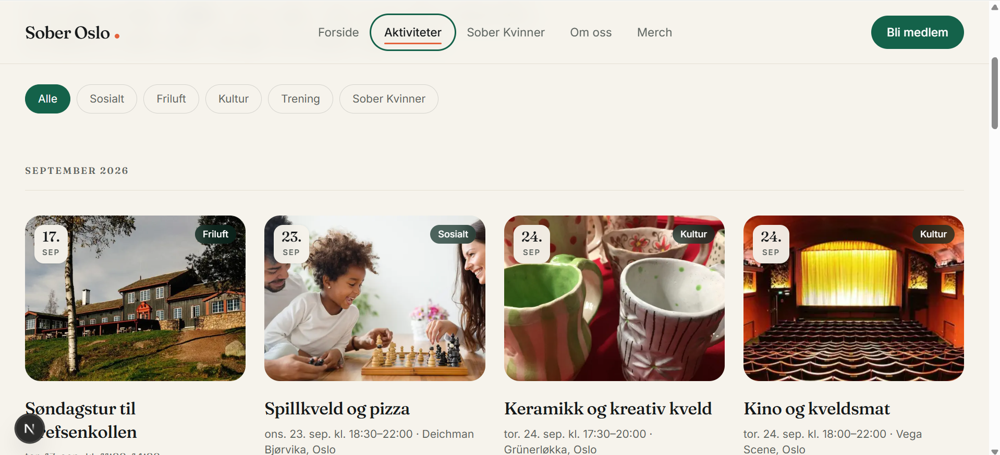
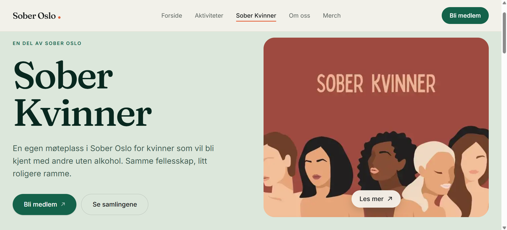
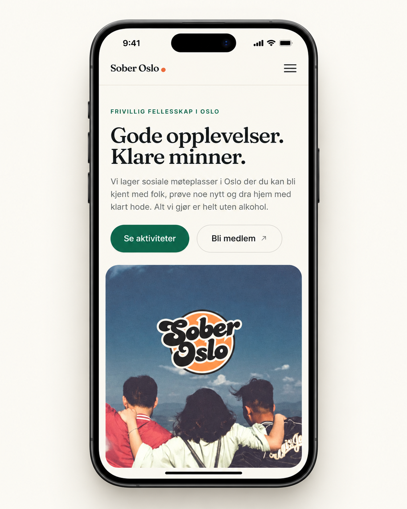

# Sober Oslo

Nettsiden til Sober Oslo. Bygget med Next.js, Tailwind CSS og Sanity CMS.

The website is in Norwegian; the code and these notes are in English.

---

## Skjermbilder

Bildefilene ligger i [`docs/screenshots/`](docs/screenshots/). Legg dem inn med
navnene under, så vises de her av seg selv. Mappen har en egen veiledning med
filnavn, anbefalt størrelse og hvordan du tar bildene.

<!-- Slett kommentartegnene rundt en linje når filen er lagt inn. -->

<!--  -->

<!--  -->

<!--  -->

<!--  -->

<!--  -->

---

## For editors

Everything on the site is edited at **`/studio`** on the live domain, for example
`https://soberoslo.no/studio`. Sanity handles the sign-in, so you log in with the
account you were invited with. No other password exists.

The menu on the left has seven things, in the order the visitor meets them:

| Menu item           | What it controls                                                  |
| ------------------- | ----------------------------------------------------------------- |
| **Aktiviteter**     | Every activity: date, place, text, pictures, sign-up              |
| **Forsiden**        | Every heading and text on the home page, in six tabs              |
| **Aktivitetssiden** | The headings on the activities overview, in three tabs            |
| **Om oss**          | The About page, in four tabs                                      |
| **Sober Kvinner**   | The Sober Kvinner page, in four tabs                              |
| **Merch**           | The picture, the shop address it links to, and the membership box |
| **Innstillinger**   | Name, membership link, contact details, social media, footer      |

### The rule to remember

**An empty field means no text on the website.** Clear a heading and the heading
is gone from the page, not replaced by something else. Nothing is required, so
you decide what the page shows.

Two exceptions, both so nothing ends up broken:

- **Button labels** keep their standard wording, because a button with no words
  on it is broken rather than empty. Clear the footer's membership label and the
  whole button disappears instead.
- **Addresses** keep their standard value, so a button never points nowhere.

Every field says what its standard wording is, so you can copy it back in if you
change your mind.

### A few other things worth knowing

- **Nothing is live until you press Publish.** Drafts stay hidden.
- **To hide an activity without deleting it**, switch off _Publisert på
  nettsiden_.
- **Past activities move by themselves.** The day after an activity happens it
  leaves the upcoming list and appears under _Tidligere aktiviteter_.
- **If there are no upcoming activities, the site says so.** It never invents
  any.
- **Pictures must be JPG, PNG or WebP.** SVG is rejected when you upload,
  because the website cannot show it.
- **Bildebeskrivelse** next to each picture is what a blind visitor hears. Leave
  it empty only when the picture is pure decoration.
- **The "Bli medlem" buttons** all point at _Innstillinger → Lenke til
  medlemskap_. Change it there once and it changes everywhere.
- **Social media is a list you control.** Add a row for each channel you have,
  with the name and the address. Delete a row to remove it from the footer.
- **Every page has a Bli medlem tab** for the dark green box at the bottom.
- **The merch page is one picture that links to the shop**, which is a separate
  site. There is no product list to maintain.
- Changes appear on the website within a minute.

---

## For developers

### Getting started

```bash
npm install
cp .env.example .env.local   # fill in the Sanity values
npm run dev
```

The site runs at `http://localhost:3000` and the editor at
`http://localhost:3000/studio`.

**The site runs without Sanity.** With no project id set, every page falls back
to the starter content in `src/lib/site.ts`, so the design can be reviewed
before the CMS exists. Once a project id is set, the CMS is the only source: the
starter activities can never appear on a connected site.

### Connecting Sanity

1. Create a project at [sanity.io/manage](https://sanity.io/manage) and note the
   project id.
2. Put the id and dataset in `.env.local`.
3. Allow the origins that need to reach the API, and nothing more:

   ```bash
   npx sanity cors add http://localhost:3000 --credentials
   npx sanity cors add https://soberoslo.no --credentials
   ```

4. Invite the Sober Oslo editors from the project's Members tab.

The website itself needs no write token: content is read from the public CDN
and the Studio authenticates each editor directly with Sanity. The one write
token, `SANITY_WRITE_TOKEN`, belongs to the ChatGPT connection and is only read
on the server, in `src/sanity/writeClient.ts`. See
[Koble ChatGPT til nettsiden](#koble-chatgpt-til-nettsiden).

Note that the dataset is public. The website hides unpublished activities, but
anyone who queries the API directly can read them, so do not stage anything
sensitive in a draft.

### Environment variables

| Variable                         | Required | Notes                                    |
| -------------------------------- | -------- | ---------------------------------------- |
| `NEXT_PUBLIC_SANITY_PROJECT_ID`  | yes      | Public value, not a secret               |
| `NEXT_PUBLIC_SANITY_DATASET`     | yes      | Usually `production`                     |
| `NEXT_PUBLIC_SANITY_API_VERSION` | no       | Defaults to `2024-10-01`                 |
| `NEXT_PUBLIC_SITE_URL`           | no       | Used for canonical links and the sitemap |
| `SANITY_WRITE_TOKEN`             | for ChatGPT | **Secret.** Sanity token, Editor role |
| `MCP_ACCESS_TOKEN`               | for ChatGPT | **Secret.** Board password, 32+ characters |
| `MCP_PUBLIC_URL`                 | no       | Overrides the origin used for OAuth      |
| `MCP_OAUTH_EXTRA_REDIRECT_URIS`  | no       | Extra allowed OAuth redirect addresses   |

The four `NEXT_PUBLIC_` values are public by design. **Never add a secret with a
`NEXT_PUBLIC_` prefix**, as those are compiled into the browser bundle. The two
secrets are read only in server code that imports `server-only`.

`NEXT_PUBLIC_SITE_URL` must be the real domain in production. Left unset it
defaults to `https://soberoslo.no`; pointing it at localhost would put localhost
addresses in the sitemap and in every canonical link.

### Deploying to Vercel

Import the repository, add the environment variables above, and deploy. No other
configuration is needed. Remember to add the Vercel domain as a Sanity CORS
origin.

### How content resolves

`src/lib/content.ts` is the only place the CMS is read. Two helpers decide what a
page shows:

- `textFrom(document)` returns the editor's value once the document exists in
  Sanity, empty included. The built-in wording is used only when the document
  has never been created.
- `listFrom(document)` does the same for lists.

Pages then guard on empty strings, so a cleared field removes the element rather
than leaving a blank line behind.

### Project layout

```
src/
  app/
    (site)/            the public website, with header and footer
      error.tsx        branded error page, no technical detail shown
      not-found.tsx    404 inside the site
    (studio)/studio/   Sanity Studio, its own root layout
    globals.css        design tokens, typography, motion
  components/
    layout/            header, mobile menu, footer
    ui/                container, button, headings, reveal, marquee, media,
                       show-more grid, placeholder artwork
    activities/        cards, grid, meta, category filter
    media/             gallery with lightbox
    ImageLink.tsx      one large picture that links to another site
    MembershipCTA.tsx  the dark green box at the bottom of every page
  lib/
    site.ts            navigation, brand values, starter content
    content.ts         reads the CMS and decides what each page shows
    format.ts          Norwegian dates and times
    urls.ts            validates links that come from the CMS
    mcp/               the ChatGPT connection: tools, OAuth, validation,
                       safe image download, rate limiting, audit log
  app/api/mcp/         the MCP endpoint ChatGPT talks to
  app/api/oauth/       login, token, registration and discovery for ChatGPT
  sanity/
    writeClient.ts     server-only client with the write token
    schemaTypes/       the document types editors see
      imageRules.ts    rejects SVG uploads
    structure.ts       the Studio menu
    queries.ts         GROQ queries
    fetch.ts           reads Sanity, and today's date in Oslo time
sanity.config.ts       Studio configuration
```

### Design system

Tokens live at the top of `src/app/globals.css` and are used through Tailwind
classes such as `bg-cream`, `text-ink` and `text-green`.

| Token | Value     | Use                                   |
| ----- | --------- | ------------------------------------- |
| cream | `#f6f3ec` | Page background                       |
| paper | `#fffcf5` | Cards and the footer                  |
| ink   | `#16191a` | Body text                             |
| muted | `#5d6460` | Secondary text (5.5:1 on cream)       |
| green | `#14624a` | Primary brand colour (6.6:1 on cream) |
| sage  | `#dce7db` | Quiet section backgrounds             |
| coral | `#e4633c` | Highlights, used sparingly            |

Type is Fraunces for headings and Inter for everything else, both self-hosted by
`next/font`.

Motion is deliberately small: a fade-and-unblur on scroll (`Reveal`), a staggered
headline (`AnimatedHeading`), a slow photo marquee, and hover states around 2–3%.
All of it is switched off by `prefers-reduced-motion`, and a `<noscript>` rule
shows every revealed element when JavaScript is unavailable.

### Accessibility notes

- One `h1` per page, `lang="nb"`, a skip link, and a visible focus ring
  everywhere.
- The picture viewer is a modal with a focus trap, Escape to close, and arrow
  keys to move between pictures. It is rendered into `document.body` so it
  always covers the screen.
- The photo marquee pauses on hover and on keyboard focus, which is what
  WCAG 2.2.2 asks for. A visible pause button would be more discoverable but
  would change the design.
- `button` is given `cursor: pointer` in `globals.css`, because Tailwind 4 leaves
  buttons on the default arrow.

### Dates

`todayIso()` in `src/sanity/fetch.ts` returns today in **Europe/Oslo**, not UTC.
Servers run on UTC, so using UTC would keep yesterday's activity listed as
upcoming between midnight and 01:00 or 02:00 Norwegian time.

### Security

- No database, no visitor accounts, no analytics or cookies.
- The only API routes are the ChatGPT connection under `/api/mcp` and
  `/api/oauth`. Every MCP request needs a valid token, and the login page is
  rate limited. Its two secrets, `SANITY_WRITE_TOKEN` and `MCP_ACCESS_TOKEN`,
  are server-only. Everything else is a public Sanity identifier.
- CMS text is rendered as React elements through Portable Text. There is no
  `dangerouslySetInnerHTML` anywhere, so content cannot inject markup.
- Links from the CMS are validated in `src/lib/urls.ts`. Only `http(s)` and
  `mailto` survive, and an internal path is resolved against a stand-in origin so
  shapes like `//evil.com` and `/\evil.com` cannot escape to another domain.
  External links carry `rel="noopener noreferrer"`.
- Images may only load from `cdn.sanity.io` (`next.config.ts`), and SVG uploads
  are rejected in the schema rather than enabling `dangerouslyAllowSVG`.
- Security headers are set in `next.config.ts`: a Content Security Policy,
  `X-Content-Type-Options`, `Referrer-Policy`, `Permissions-Policy`,
  `Strict-Transport-Security` and `frame-ancestors 'none'`.

The script policy still allows `'unsafe-inline'`, because the App Router emits
inline bootstrap scripts. Tightening that means adding a middleware that issues a
nonce per request, which also makes every page render dynamically. Given that no
untrusted HTML is ever rendered here, the trade was not worth it.

Video support was removed from the site. The Content Security Policy still lists
YouTube, Vimeo and the Sanity file CDN under `frame-src` and `media-src`. Nothing
uses them now, so they can be dropped whenever someone is in that file.

`agentRules: false` in `next.config.ts` stops Next.js from writing `AGENTS.md`
and `CLAUDE.md` into the project root on every `next dev`.

### Known dependency warnings

`npm audit` reports 15 issues, one of them high. All of them are the same
package, `js-yaml@3.13.1`, reached only through the Sanity command line tool:

```
sanity -> @sanity/cli -> @vercel/frameworks -> js-yaml
```

It is not reachable from the website. Next.js file tracing includes 2545 files in
the deployed server and `js-yaml` is not among them, so it ships nowhere and runs
never. There is no upstream fix: the newest `@vercel/frameworks` still pins that
exact version, and `npm audit fix --force` would **downgrade** `sanity` a whole
major version, which breaks the Studio. Do not run it.

If a clean audit is wanted, pin the patched release for that one path only:

```json
"overrides": {
  "@vercel/frameworks": { "js-yaml": "3.15.2" }
}
```

A bare `"js-yaml": "^3.15.2"` would also drag ESLint's `js-yaml@4` down to 3.x
and break linting, so the nesting matters.

### Scripts

```bash
npm run dev     # development server
npm run build   # production build
npm start       # serve the production build
npm run lint    # ESLint
npm run mcp:test     # checks the ChatGPT connection, see below
npm run mcp:inspect  # opens MCP Inspector
```

---

## Koble ChatGPT til nettsiden

Styret kan opprette og endre aktiviteter og merch-siden ved å skrive til
ChatGPT, for eksempel «Lag en ny aktivitet: Spillkveld fredag 23. oktober kl. 18,
gratis, på Deichman Bjørvika» eller «Legg til en hettegenser til 499 kr på
merch-siden». ChatGPT er adminpanelet. Det finnes ingen egen chat på nettsiden.

```
ChatGPT  →  https://soberoslo.no/api/mcp  →  Sanity  →  nettsiden
           (MCP over Streamable HTTP,      (skrive-token,
            innlogging med OAuth)           bare på serveren)
```

ChatGPT krever OAuth for tilkoblinger med innlogging. Nettsiden har derfor en
egen, enkel innloggingsside. Første gang tilkoblingen legges til, åpner ChatGPT
den, og man skriver inn styrets passord (`MCP_ACCESS_TOKEN`). Etterpå husker
ChatGPT innloggingen i opptil 60 dager.

### 1. Lag et Sanity-token

1. Gå til [sanity.io/manage](https://sanity.io/manage), velg prosjektet og
   **API → Tokens → Add API token**.
2. Gi det navnet `ChatGPT` og velg rollen **Editor**. Ikke velg Administrator,
   for tokenet skal bare kunne endre innhold, ikke prosjektet.
3. Kopier tokenet. Det vises bare én gang.

### 2. Lag styrets passord

Kjør dette og kopier det som skrives ut:

```bash
node -e "console.log(require('crypto').randomBytes(32).toString('base64url'))"
```

Passordet må være minst 32 tegn, ellers er tilkoblingen slått av. Del det bare
med styret, for eksempel i en passordbehandler.

### 3. Legg inn miljøvariablene i Vercel

Vercel → prosjektet → **Settings → Environment Variables**:

| Navn                 | Verdi                    | Miljø      |
| -------------------- | ------------------------ | ---------- |
| `SANITY_WRITE_TOKEN` | tokenet fra steg 1       | Production |
| `MCP_ACCESS_TOKEN`   | passordet fra steg 2     | Production |

Kryss av for **Sensitive**. Bruk aldri `NEXT_PUBLIC_` foran disse navnene. Deploy
på nytt etterpå, så variablene blir tatt i bruk.

Lokalt legger du de samme verdiene i `.env.local`, som aldri sjekkes inn i git.

### 4. Legg til tilkoblingen i ChatGPT

Egne MCP-tilkoblinger krever **utviklermodus** i ChatGPT. Den finnes på nett
(chatgpt.com) for Plus, Pro, Business, Enterprise og Edu. I et Business- eller
Enterprise-arbeidsområde må en administrator slå det på først. OpenAI flytter
menyene innimellom, så navnene kan avvike litt:

1. Åpne **Innstillinger → Apper** (Apps & Connectors) **→ Avanserte innstillinger**
   og slå på **Utviklermodus** (Developer mode).
2. Velg **Opprett** (Create app) og fyll inn:
   - **Navn:** Sober Oslo
   - **Beskrivelse:** Opprett og endre aktiviteter og merch på soberoslo.no
   - **MCP-server-URL:** `https://soberoslo.no/api/mcp`
   - **Autentisering:** OAuth
3. Bekreft at du stoler på appen og trykk **Opprett**.
4. Innloggingssiden til Sober Oslo åpnes. Skriv inn styrets passord og trykk
   **Gi tilgang**.
5. ChatGPT henter de 13 verktøyene. I en ny samtale velger du **Sober Oslo**
   under **+ → Mer** (eller utviklermodus-menyen) for å bruke den.

Er tilkoblingen allerede lagt til fra før merch-verktøyene kom, åpner du appen
i ChatGPT-innstillingene og trykker **Oppdater** (Refresh), så hentes de nye
verktøyene.

ChatGPT spør alltid om bekreftelse før den oppretter, endrer, skjuler eller
sletter noe. Verktøyene ber den i tillegg oppsummere først.

### Eksempler på hva styret kan skrive

- «Hvilke aktiviteter har vi fremover?»
- «Lag en ny aktivitet: Spillkveld fredag 23. oktober kl. 18–21, gratis, på
  Deichman Bjørvika, fjerde etasje. Kort beskrivelse: Brettspill og kaffe, alle
  er velkomne.»
- «Flytt spillkvelden til kl. 19 og sett pris til 50 kr.»
- «Legg til i praktisk info at vi møtes ved inngangen.»
- «Bruk dette bildet som hovedbilde på spillkvelden» (med bildet lastet opp i
  chatten).
- «Avlys turen på lørdag» gjør at aktiviteten skjules. Den slettes ikke.
- «Slett testaktiviteten for godt» sletter permanent. ChatGPT må gjenta
  tittelen for at det skal virke.

Mangler dato, sted eller kort beskrivelse, spør ChatGPT i stedet for å gjette.
«Fredag» og «neste uke» regnes ut fra dagens dato i norsk tid.

Merch-siden:

- «Hva ligger på merch-siden nå?»
- «Legg til en hettegenser, svart, 499 kr, med lenke til
  https://butikk.soberoslo.no/hettegenser. Sett den først.»
- «Bruk dette bildet på hettegenseren» (med bildet lastet opp i chatten).
- «T-skjorta er utsolgt» merker produktet som utsolgt. Det vises med merket
  «Utsolgt» og lenker ikke til butikken.
- «Endre ingressen på merch-siden til …»
- «Bytt lenken til nettbutikken til https://…»
- «Fjern kopphylla fra merch-siden» fjerner produktet for godt. ChatGPT må
  gjenta produktnavnet for at det skal virke.

### Verktøyene

| Verktøy                   | Hva det gjør                                          |
| ------------------------- | ----------------------------------------------------- |
| `list_activities`         | Kommende aktiviteter, valgfritt tidligere og kategori |
| `get_activity`            | Alle detaljer om én aktivitet, via id eller slug      |
| `create_activity`         | Ny aktivitet. Slug lages fra tittelen og er unik      |
| `update_activity`         | Endrer bare feltene som oppgis, og kan tømme felt     |
| `set_activity_visibility` | Skjuler eller viser. Den vanlige måten å «slette» på  |
| `delete_activity`         | Permanent sletting, krever `confirm` og tittelen      |
| `upload_activity_image`   | Hovedbilde eller galleri, fra chatten eller en URL    |

| Verktøy                      | Hva det gjør                                         |
| ---------------------------- | ---------------------------------------------------- |
| `get_merch_page`             | Tekstene og alle produktene på merch-siden           |
| `update_merch_page`          | Overskrift, ingress, butikklenke, knappetekst og «Støtt arbeidet»-boksen |
| `add_merch_product`          | Nytt produkt, først eller sist i listen              |
| `update_merch_product`       | Navn, pris, beskrivelse, lenke, utsolgt, rekkefølge  |
| `remove_merch_product`       | Fjerner for godt, krever `confirm` og produktnavnet  |
| `upload_merch_product_image` | Produktbilde, fra chatten eller en URL               |

| Verktøy                | Hva det gjør                                                  |
| ---------------------- | ------------------------------------------------------------- |
| `get_surprise_ideas`   | Tekstene og alle ideene på skrapekortet («Overrask meg»)      |
| `add_surprise_ideas`   | Én eller flere nye ideer. Dubletter hoppes over               |
| `update_surprise_idea` | Endrer ideen eller den morsomme teksten under                 |
| `remove_surprise_idea` | Fjerner for godt, krever `confirm` og ideen                   |
| `update_surprise_page` | Overskrift og undertekst over skrapekortet                    |

Be ChatGPT om for eksempel «finn på fem nye ideer til skrapekortet». Den
henter listen først, foreslår ideer i samme stil og lagrer bare de du godkjenner.

Endringer vises på nettsiden med en gang, fordi sidene som berøres oppdateres
etter hver skriving. Har en aktivitet eller merch-siden et upublisert utkast
åpent i Studio, skrives endringen også dit, så neste Publish i Studio ikke
overskriver den.

Et tomt tekstfelt på merch-siden betyr at teksten forsvinner fra nettsiden,
akkurat som i Studio. Finnes ikke merch-siden i Sanity fra før, opprettes den
med standardtekstene første gang ChatGPT endrer noe, så siden ikke blir tom.

### Sikkerhet

- **Innlogging:** OAuth 2.1 med PKCE. Koder gjelder i fem minutter og kan bare
  brukes én gang. Tilgangstokens gjelder i åtte timer og fornyes automatisk i
  opptil 60 dager. Innloggingen kan bare sende brukeren tilbake til ChatGPT
  eller til egen maskin (for testing).
- **Logg ut alle:** bytt `MCP_ACCESS_TOKEN` i Vercel og deploy på nytt. Da slutter
  alle tokens å virke, og styret må logge inn på nytt med det nye passordet.
- **Begrensninger:** 10 innloggingsforsøk per 15 minutter, 120 forespørsler per
  minutt og 60 endringer i timen per tilkobling. Grensene telles per
  serverinstans, så de er et vern mot misbruk, ikke en eksakt kvote.
- **Logg:** hver endring skrives til Vercels logg med prefikset `[mcp-audit]`:
  tidspunkt, verktøy, dokument-id, feltnavn og hvilken klient det var.
  Verdier og tokens logges ikke. Alle i styret deler samme passord, så loggen
  viser hvilken tilkobling, ikke hvilken person.
- **Bilder:** bare `https` på standardport. Private og lokale IP-adresser
  blokkeres (sjekket ved hver tilkobling og hver videresending), maks 10 MB,
  15 sekunders tidsgrense. Filtypen avgjøres av innholdet: bare JPG, PNG og
  WebP. SVG avvises.
- **CSP:** `/api/mcp` svarer med JSON, som ikke påvirkes av sidens Content
  Security Policy. Innloggingssiden har sin egen, strengere policy uten
  skript, fordi sidens `form-action 'self'` ellers ville stoppet
  videresendingen tilbake til ChatGPT.

### Test lokalt før du kobler til ChatGPT

Legg `SANITY_WRITE_TOKEN` og `MCP_ACCESS_TOKEN` i `.env.local` og start
utviklingsserveren:

```bash
npm run dev
```

**Rask sjekk med testskriptet**, i et nytt terminalvindu:

```bash
MCP_ACCESS_TOKEN=<passordet> npm run mcp:test            # bare lesing
MCP_ACCESS_TOKEN=<passordet> npm run mcp:test -- --write # også skriving, se under
```

Det sjekker at uautoriserte kall avvises, at OAuth-oppsettet svarer, at alle
13 verktøyene finnes, og at feil input gir norske feilmeldinger. Med `--write`
opprettes, endres og slettes også en skjult testaktivitet, og et utsolgt
testprodukt legges til på merch-siden og fjernes igjen. Det er synlig der i
noen sekunder. Sett
`MCP_URL=https://soberoslo.no/api/mcp` for å sjekke nettsiden etter deploy.

**Prøv verktøyene for hånd med MCP Inspector:**

```bash
npm run mcp:inspect
```

1. Inspector åpnes i nettleseren. Velg **Transport Type: Streamable HTTP** og
   **URL:** `http://localhost:3000/api/mcp`.
2. Under **Authentication**: skriv `MCP_ACCESS_TOKEN` som **Bearer Token**.
   Du kan også teste hele OAuth-innloggingen slik ChatGPT gjør det, med
   **Open Auth Settings → Quick OAuth Flow**.
3. Trykk **Connect**, så **Tools → List Tools**, og kjør for eksempel
   `list_activities`.

ChatGPT kan ikke nå `localhost`. For å teste mot ChatGPT før produksjon, bruk en
preview-deploy på Vercel med de samme miljøvariablene, eller en tunnel som
`ngrok http 3000`.
